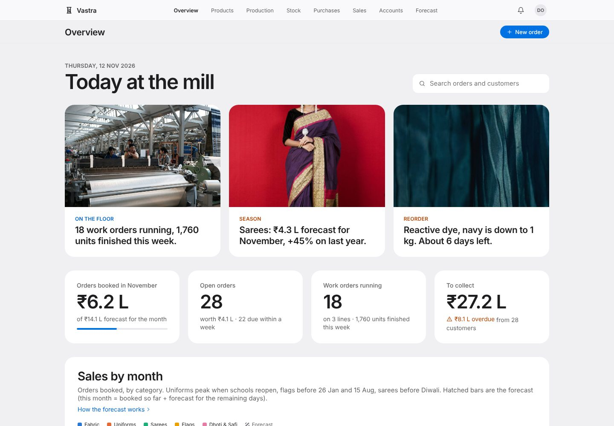
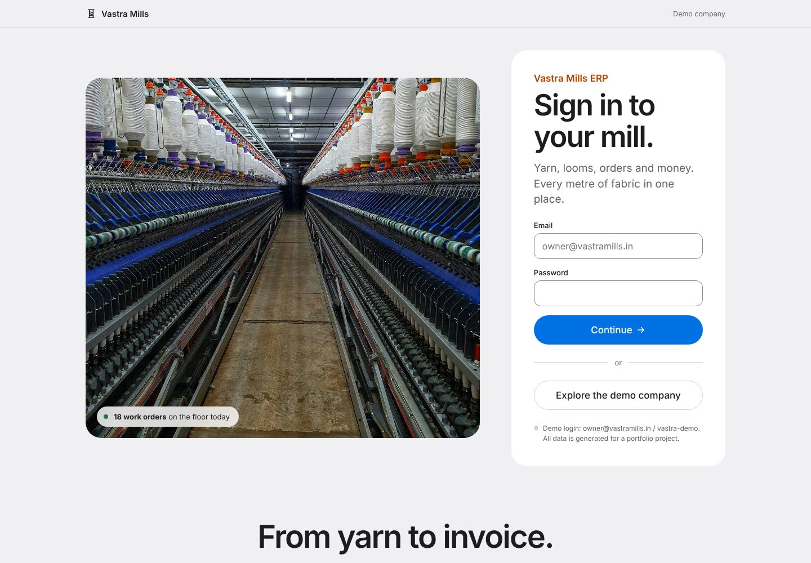
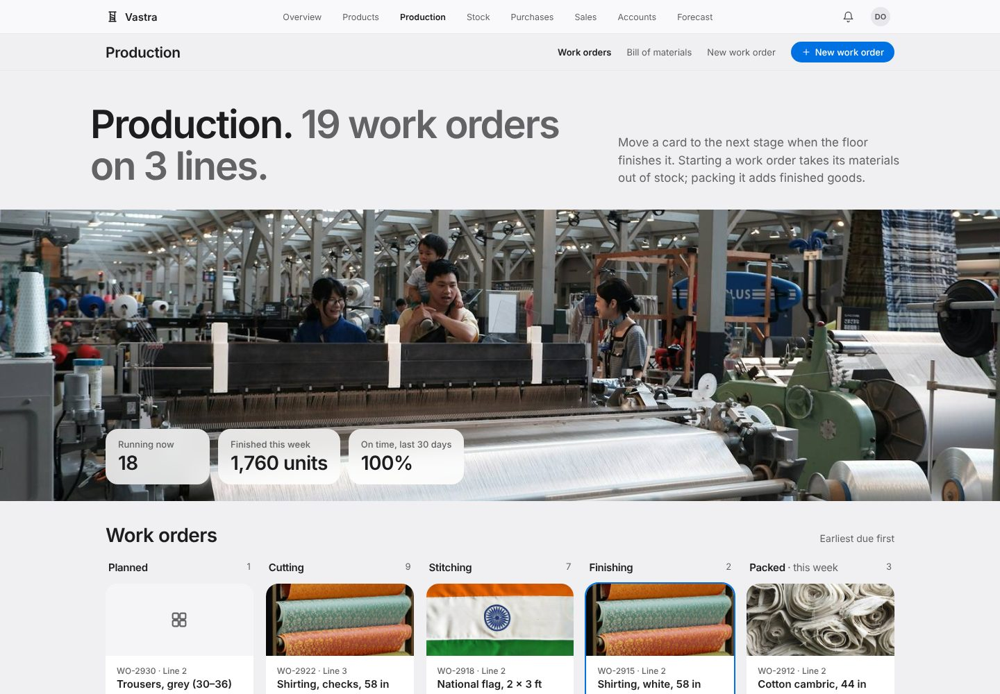
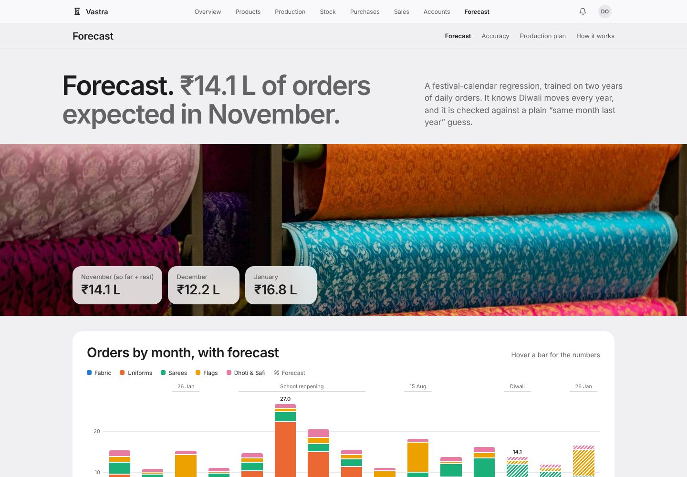
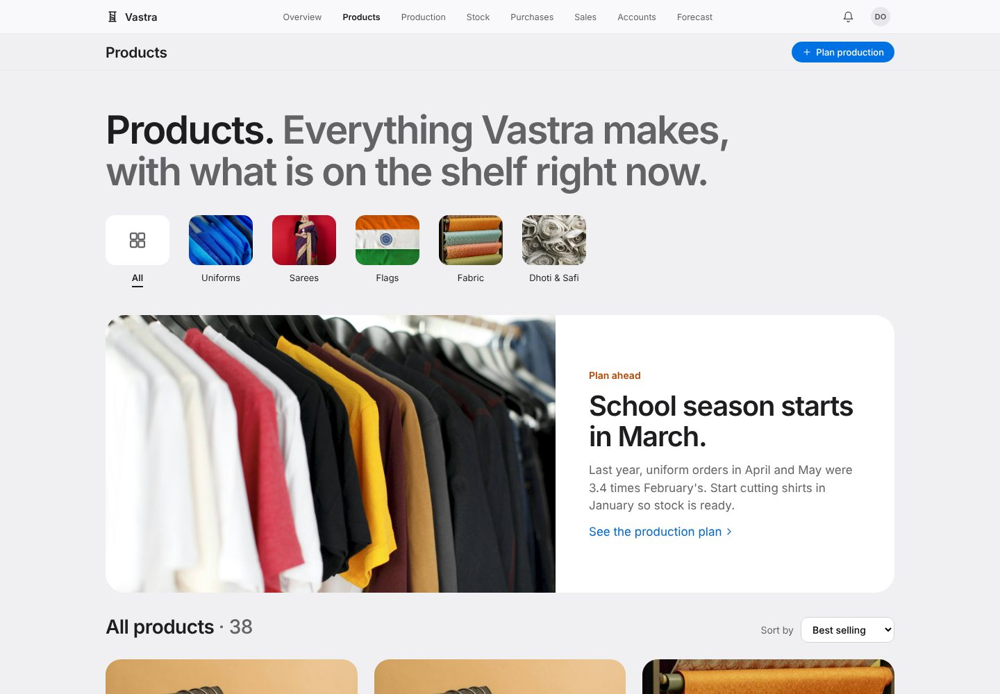
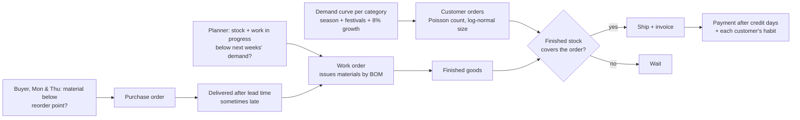

# Vastra Mills ERP

A working ERP (enterprise resource planning) system for a small textile mill that makes **school uniforms, sarees, national flags, dhoti & safi, and fabric sold by the metre**. Built with **FastAPI + Jinja web pages + SQLAlchemy**, with two years of simulated business history, a **festival-aware demand forecast**, reorder points with **EOQ**, and CSV feeds for **Power BI**.

Vastra Mills is a demo company. Every customer, supplier and number is generated.



| Sign-in | Production board |
|---|---|
|  |  |
| **Forecast** | **Products** |
|  |  |

## Why this project

Small Indian textile businesses run on registers, WhatsApp and memory. Three problems come up again and again:

1. **Seasonal rushes catch them short.** Uniform orders triple when schools reopen, flags spike before 26 January and 15 August, sarees before Diwali (which moves every year).
2. **Material runs out mid-order.** Nobody knows how many days of yarn or buttons are left.
3. **Money gets stuck with customers.** Credit is given freely and overdue invoices are found late.

This app puts stock, production, purchasing, sales and money in one place, and adds a forecast so the owner can plan before the rush.

## What it does

| Module | What you can do | The logic behind it |
|---|---|---|
| **Overview** | See today's work, key numbers, sales chart with forecast, what to reorder | All numbers are computed live from the transaction tables |
| **Products** | Browse 38 products with photos, stock, margin; open a product for its bill of materials | Unit cost = materials from the BOM + labour |
| **Production** | Work-order board (Planned → Cutting → Stitching → Finishing → Packed); create work orders | Starting a work order **issues materials** from stock; packing it **adds finished goods** |
| **Stock** | Finished goods and materials, free stock, safety stock, days left | Stock = sum of a **stock ledger** (`stock_moves`), never a typed-in number |
| **Purchases** | Reorder list, raise POs (one per supplier), receive deliveries, pay suppliers, supplier on-time scorecard | **Reorder point** = daily use × lead time + safety stock; order quantity = **EOQ** |
| **Sales** | Book orders, ship them (only if stock covers every line), invoices, record payments, top customers | Shipping writes the invoice; the customer's credit days set the due date |
| **Accounts** | Monthly profit and loss, receivables ageing, payables | Sales − materials − labour − overheads |
| **Forecast** | 3-month forecast by category, backtest vs a baseline, this-month check, 30-day production plan | Ridge regression on calendar and festival features (below) |
| **Export** | CSV feeds for Power BI | SQL views in `sql/views.sql` |

## The data: a small simulation, not random rows

`app/seed.py` plays out every day from **1 Nov 2024 to 12 Nov 2026** (the demo date):



Result: about **3,000 orders** (₹3.7 crore), 2,950 invoices, 3,100 payments, 1,900 work orders, 390 purchase orders and 15,000 stock-ledger rows, all consistent with each other. Some customers pay late on purpose, so receivables ageing has a story to tell.

## The forecast

**Baseline:** "next month = the same month last year". Simple and often good, until a festival moves. Diwali was on **21 Oct 2025** but falls on **8 Nov 2026**.

**Model:** for each category, daily sales are fitted with **ridge regression** on calendar features:

- month of year (12 dummies), Sunday
- days before Diwali in four windows (sarees, dhoti & safi)
- days before 26 Jan / 15 Aug in three windows (flags)
- wedding season (sarees, dhoti & safi)

Older days are scaled up by the recent **year-on-year growth**, so the model forecasts at today's level. Ridge (least squares with a small penalty) keeps 13–21 weights stable on ~740 days.

**Checking it honestly:**

- **Rolling-origin backtest:** four forecasts made at the end of Apr, May, Jun and Jul 2026, each for the next three months, scored with **WAPE** (sum of absolute errors / sum of actuals). On these months the model (≈13% overall) and the baseline (≈11%) are close, because no festival moved inside them.
- **This-month check:** in the first 12 days of November 2026 the model expected ₹2.8 L of saree orders, actual was ₹2.6 L, and the baseline said ₹1.2 L. That is the case the model exists for.

The forecast drives the **production plan**: make = forecast demand (next 30 days) + safety stock + open orders − stock − work in progress, rounded up to the batch size.

## Inventory maths

- **Reorder point (ROP)** = average daily use (last 60 days) × supplier lead time + safety stock (10 days of use)
- **Position** = on hand + on order − already promised to planned work orders. Reorder when position < ROP.
- **EOQ** = √(2 × yearly use × ₹600 order cost ÷ (20% × unit cost)). Big enough to save on ordering, small enough not to tie up cash.

## How it is built

```
app/
  main.py            FastAPI app, sessions, startup (builds the demo DB if missing)
  db.py              SQLAlchemy engine: SQLite by default, Postgres via DATABASE_URL
  models.py          16 tables: products, materials, BOM, orders, invoices, payments, POs, work orders, stock ledger...
  seed.py            the two-year simulation
  services/
    metrics.py       stock, reorder points, EOQ, KPIs, receivables, P&L
    forecast.py      calendar ridge regression, backtest, production plan
    ops.py           business actions: start/advance work orders, ship, invoice, receive, pay
    charts.py        server-side HTML charts (no JS library), colour-blind-safe palette
  routers/           one file per module
  templates/         Jinja pages, light grey Apple-style design
  static/            CSS and photos
sql/views.sql        analytics views (run on SQLite and Postgres)
tests/test_app.py    22 tests: pages, stock ledger, actions, forecast, exports
docs/POWERBI_GUIDE.md  step-by-step Power BI build
```

## Run it on your computer (Windows)

```bat
cd C:\GitHub\vastra-erp
python -m venv .venv
.venv\Scripts\activate
pip install -r requirements-dev.txt
python -m app.seed
uvicorn app.main:app --reload
```

Open http://127.0.0.1:8000 and click **Explore the demo company** (or sign in with `owner@vastramills.in` / `vastra-demo`).
Run the tests with `pytest -q`. Rebuild the data any time with `python -m app.seed`.

## Deploy free on Render

1. Push this repo to GitHub.
2. On render.com: **New → Blueprint**, pick the repo. `render.yaml` sets everything (build, start, health check, secret key).
3. The first start builds the demo database. On the free plan the disk resets when the service restarts, so the demo always comes back to the 12 Nov 2026 story.

To keep data between restarts, create a Render Postgres database, set `DATABASE_URL`, and add `psycopg[binary]` to `requirements.txt`. No code changes: every query goes through SQLAlchemy.

## Power BI

`/export` lists CSV links, one per SQL view. In Power BI Desktop: **Get data → Web**, paste a link (it includes `?key=`). The full build guide with the data model and DAX measures is in [docs/POWERBI_GUIDE.md](docs/POWERBI_GUIDE.md).

## Limits (said plainly)

- Data is simulated. Patterns are realistic but were designed, so the model is learning patterns I put in.
- Two years of history is short for seasonal models; the backtest covers only four forecast origins.
- One user role; no GST invoices, no batch/lot tracking, no multi-warehouse stock.

## Photo credits

Photos from [Unsplash](https://unsplash.com) under the free Unsplash License, resized for the web: Prince Prabhakaran, Ryo Harianto, Bernd Dittrich, Bulbul Ahmed, Richard Williams, Nimble Made, Parker Burchfield, Tim Mossholder, Onkarphoto, Saradasish Pradhan, Ethan Bodnar, Eric Muhr, CR, Ranurte, Phil Hearing, Matin Hosseini, AZUKI .V and Vishal Banik. File-by-file list with links: [docs/photo_credits.json](docs/photo_credits.json).
